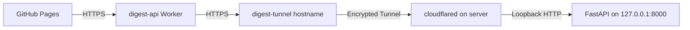

# Digest HTTPS API

Public entry point: `https://digest-api.vincentws.com/api`.



The `daily-ai-digest-api` Worker forwards only `/health` and `/api/` paths to a
fixed HTTPS origin, handles the dashboard's CORS preflight, disables response
caching, and rewrites origin redirects to the public HTTPS hostname.

Worker bindings:

- `ORIGIN_URL=https://digest-tunnel.vincentws.com`
- `ALLOWED_ORIGINS=https://senweiv.github.io`

The managed Tunnel is named `daily-ai-digest-api`. Its ingress configuration is
in `tunnel-ingress.json`. The proxied CNAME for `digest-tunnel.vincentws.com`
points to the managed Tunnel's `<UUID>.cfargotunnel.com` address. Its local
service is `http://127.0.0.1:8000`; no provider or SMTP credentials enter the Worker.

The server runs cloudflared 2026.10.3 through `daily-ai-digest-tunnel.service`.
The downloaded binary's SHA-256 was checked against the official release asset:
`053b80b0a23031a038fdbf3c073f59f82b8f1f152aa67971d7383ffafc0dbab0`.
The Tunnel token is held only in `/etc/cloudflared-digest/token` with mode 600.
Retrieve it through the connected Cloudflare API when provisioning a server;
do not commit it or put it in a shell command line.

Checks:

```bash
node --test infra/cloudflare/digest-api.test.mjs
systemctl status daily-ai-digest-tunnel.service
curl https://digest-api.vincentws.com/health
```

The Pages workflow accepts a configured HTTPS API variable. Empty or legacy HTTP
values use the public HTTPS entry point. Management operations require the
backend's `ADMIN_API_KEY`; the browser asks for it when needed and retains it
only in session storage. It is never included in the public build.

Backend deployment continues through `scripts/baidu-server.sh deploy`; the
separate Tunnel service survives backend container replacements. Back up its
service file and token privately before moving servers. Roll back a failed
backend deployment using the saved source/image and environment backup.
